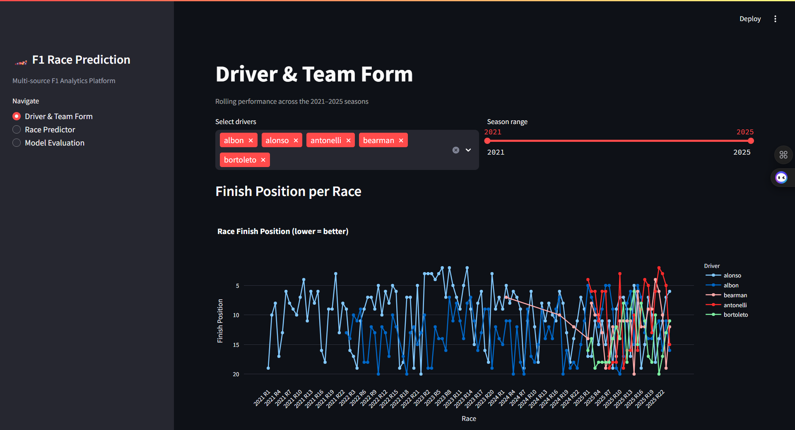
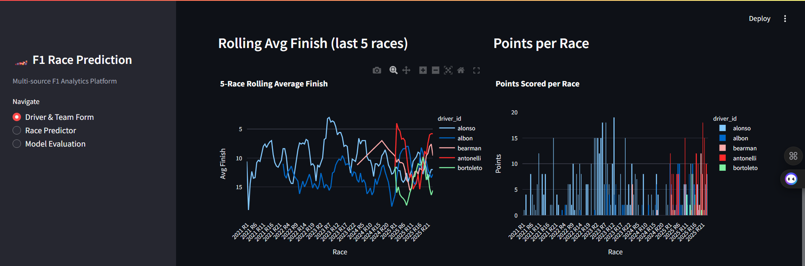
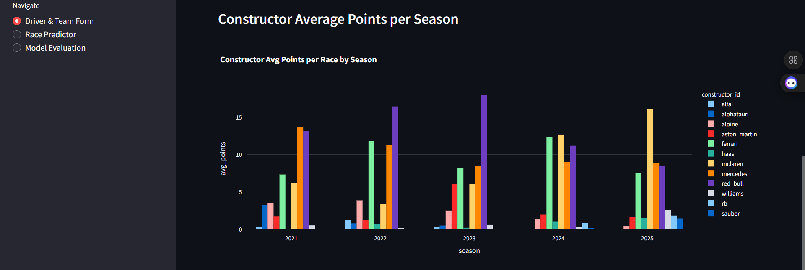
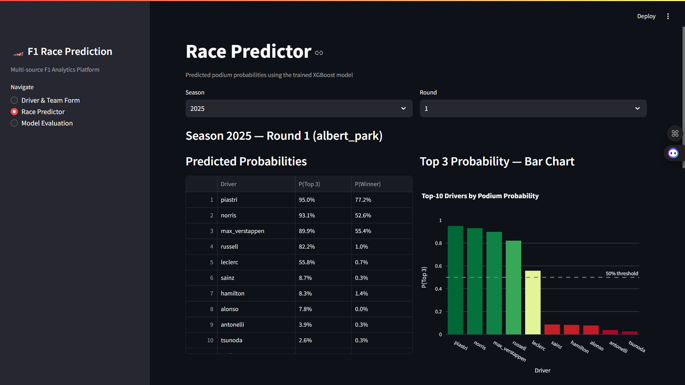
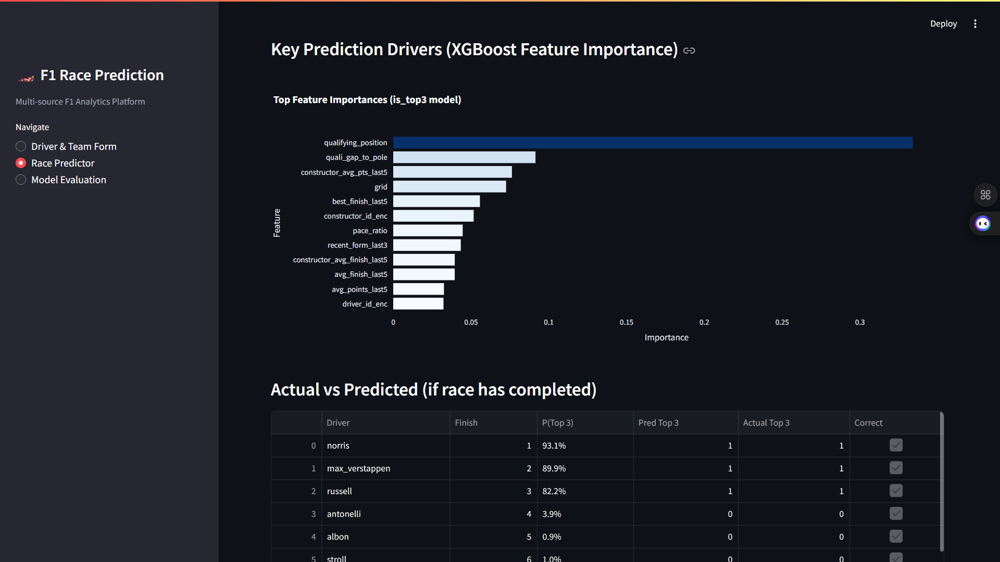
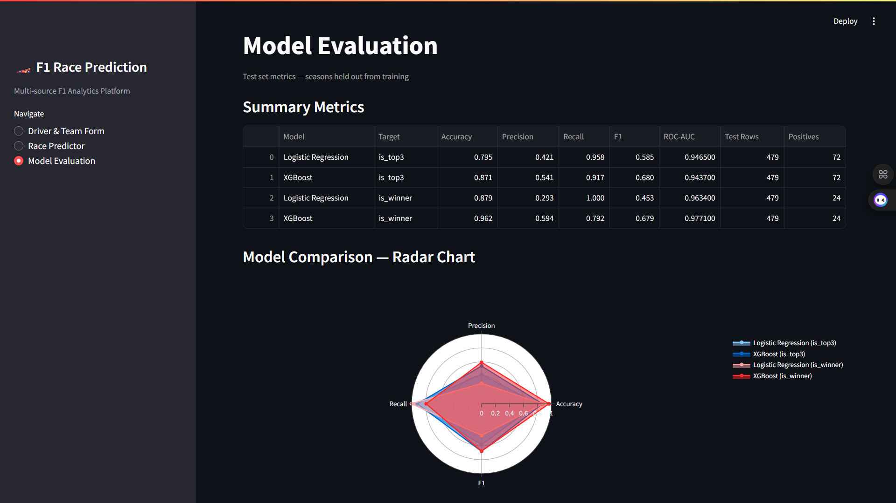
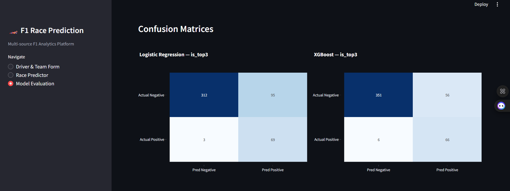
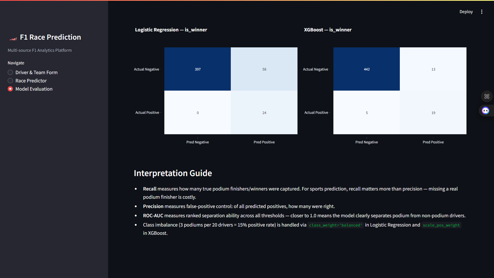

# 🏎️ F1 Race Prediction: End-to-End ML Platform for Formula 1 Outcomes

**F1 Race Prediction** is a production-grade data engineering and machine learning solution designed to bridge the gap between raw multi-source Formula 1 telemetry and actionable race outcome predictions — from API ingestion through feature engineering to a deployed Streamlit prediction interface.

---

## 🎯 Project Goal

Formula 1 outcomes are shaped by driver skill, constructor performance, qualifying pace, track characteristics, and race strategy. This project builds a complete supervised learning platform that ingests data from three complementary APIs (Jolpica, OpenF1, FastF1), engineers race-level and driver-level rolling features, trains and compares classification models for podium and winner prediction, and serves predictions through an interactive Streamlit app — mirroring real analytics workflows used in sports intelligence and race strategy teams.

---

## 🧬 System Architecture

1. **Jolpica API (Ergast-compatible)** — Historical baseline: race results, qualifying times, driver and constructor standings for seasons 2021–2025
2. **OpenF1 API** — Modern F1 data layer: session metadata, lap-level pace data, and tyre stint information for 2023–2025
3. **FastF1 Python Library** — Structured session-level access: sector times, speed traps, and weather metadata for selected 2025 race sessions
4. **PostgreSQL 15** — Persistent storage for all ingested tables; schema enforces referential integrity via foreign keys
5. **Processing Layer** — Canonical driver ID mapping across sources; deduplication; median imputation; schema validation
6. **Feature Pipeline** — Rolling driver form, constructor performance index, track-specific history, qualifying gap metrics, pace ratio
7. **ML Layer** — Time-aware train/val/test split; Logistic Regression baseline + XGBoost advanced; both podium and winner targets
8. **Streamlit App** — Three-page interactive interface: Driver & Team Form, Race Predictor, Model Evaluation

---

## 🛠️ Technical Stack

| **Layer** | Tool | Version |
|---|---|---|
| **Historical Ingestion** | Jolpica API (Ergast-compatible REST) | — |
| **Live/Session Ingestion** | OpenF1 API | — |
| **Lap/Session Library** | FastF1 Python | 3.8.2 |
| **Data Processing** | pandas | 2.1.4 |
| **Array Operations** | NumPy | 1.26.4 |
| **Columnar Storage** | Apache Parquet (pyarrow) | 15.0.2 |
| **Database** | PostgreSQL | 15 |
| **ORM / DB Utils** | SQLAlchemy | 2.0.36 |
| **DB Driver** | psycopg2-binary | 2.9.11 |
| **Containerisation** | Docker Compose | — |
| **ML Baseline** | scikit-learn (Logistic Regression) | 1.5.2 |
| **ML Advanced** | XGBoost | 2.1.3 |
| **Model Serialisation** | joblib | 1.4.2 |
| **Visualisation** | Streamlit + Plotly | 1.40.1 / 5.22.0 |
| **Config** | PyYAML | 6.0.2 |
| **Testing** | pytest | 8.3.3 |

---

## 📊 Performance & Results

- **Historical baseline:** 5 seasons (2021–2025), 114 races, 2,278 driver-race rows
- **OpenF1 coverage:** 89 race sessions (2023–2025) with 84,140 lap rows and 4,472 tyre stint records
- **FastF1 coverage:** 2025 race sessions — sector times, speed traps, and weather merged per session
- **Feature set:** 16 engineered features including 5-race rolling form, qualifying gap to pole, track-specific averages, constructor momentum, and pace ratio
- **is_top3 positive rate:** 15.01% (exactly 3 podiums per 20-driver field)
- **is_winner positive rate:** 5.00% (exactly 1 winner per 20-driver field)
- **Class imbalance handling:** `class_weight='balanced'` (Logistic Regression) + `scale_pos_weight=5.67` (XGBoost is_top3), `scale_pos_weight=19.0` (XGBoost is_winner)
- **Time-aware split:** Train 2021–2023 (1,320 rows) → Validate 2024 (479 rows) → Test 2025 (479 rows)

| Model | Target | Accuracy | Precision | Recall | F1 | ROC-AUC |
|---|---|---|---|---|---|---|
| Logistic Regression | is_top3 | 0.795 | 0.421 | 0.958 | 0.585 | 0.947 |
| **XGBoost** | **is_top3** | **0.871** | **0.541** | **0.917** | **0.680** | **0.944** |
| Logistic Regression | is_winner | 0.879 | 0.293 | 1.000 | 0.453 | 0.963 |
| **XGBoost** | **is_winner** | **0.962** | **0.594** | **0.792** | **0.679** | **0.977** |

- **Test suite:** 12/12 pytest tests passing — leakage checks, shape validation, target integrity

---

## 📸 Dashboard Screenshots

### Page 1 — Driver & Team Form

**Race finish position per driver across 2021–2025 (y-axis inverted, position 1 at top)**


**5-race rolling average finish + points scored per race**


**Constructor average points per season (top constructors, 2021–2025)**


---

### Page 2 — Race Predictor

**Predicted top-3 probabilities table and bar chart for a selected race**


**XGBoost feature importances and actual vs predicted comparison**


---

### Page 3 — Model Evaluation

**Summary metrics table and radar chart comparing all four models**


**Confusion matrices — is_top3 target (Logistic Regression vs XGBoost)**


**Confusion matrices — is_winner target (Logistic Regression vs XGBoost)**


---

## 📂 Project Structure

```text
formula1-race-prediction/
├── app/
│   └── streamlit_app.py          # 3-page Streamlit UI (form, predictor, evaluation)
├── artifacts/
│   └── .gitkeep                  # lgr_*.pkl, xgb_*.pkl, feature_names.json land here
├── assets/                       # Dashboard screenshots
│   ├── driver_team_finish_position.png
│   ├── rolling_avg_points_per_race.png
│   ├── constructor_avg_points_season.png
│   ├── predicted_probabilities_top3.png
│   ├── key_prediction_drivers_actual_vs_predicted.png
│   ├── summary_model_comparison.png
│   ├── confusion_matrix_top3.png
│   └── confusion_matrix_winner.png
├── config/
│   └── settings.yaml             # API URLs, season range, DB config, model hyperparams
├── data/
│   ├── raw/                      # CSV/Parquet snapshots from all three sources (gitignored)
│   ├── processed/                # cleaned_results.parquet, model_table.parquet (gitignored)
│   └── fastf1_cache/             # FastF1 session cache (gitignored)
├── metrics/
│   └── .gitkeep                  # evaluation_results.json lands here (gitignored)
├── notebooks/
│   └── 01_eda.ipynb              # EDA: class balance, correlations, driver/team trends
├── sql/
│   └── schema_postgres.sql       # DDL: 6 tables with FK constraints and indexes
├── src/
│   ├── ingestion/
│   │   ├── ingest_ergast.py      # Jolpica paginated ingestion — 2021-2025
│   │   ├── ingest_openf1.py      # OpenF1 sessions + laps + stints — 2023-2025
│   │   └── ingest_fastf1.py      # FastF1 race sessions + weather — 2025
│   ├── processing/
│   │   └── clean_data.py         # Driver ID mapping, deduplication, schema standardisation
│   ├── features/
│   │   └── build_features.py     # Rolling features, track stats, pace ratio → model_table
│   ├── models/
│   │   ├── train.py              # Time-aware split, LR + XGBoost for is_top3 / is_winner
│   │   └── evaluate.py           # Accuracy, precision, recall, F1, ROC-AUC, confusion matrix
│   └── utils/
│       ├── db.py                 # SQLAlchemy engine + ON CONFLICT upsert
│       └── io_utils.py           # settings loader, CSV/Parquet save/load helpers
├── tests/
│   └── test_features.py          # Leakage tests, shape tests, target integrity tests
├── .env.example
├── .gitignore
├── docker-compose.yml            # PostgreSQL 15 only; Python runs in local venv
└── requirements.txt
```

---

## ⚙️ Installation & Setup

**Prerequisites:** Docker Desktop, Python 3.11+

### 1. Clone and configure environment

```bash
git clone https://github.com/declerke/Formula1-Race-Prediction.git
cd formula1-race-prediction
cp .env.example .env          # Edit DB_PASSWORD if needed
```

### 2. Start PostgreSQL

```bash
docker-compose up -d
# Wait for healthy: docker-compose ps
```

### 3. Create virtual environment and install dependencies

```bash
uv venv .venv
source .venv/bin/activate     # Windows: .venv\Scripts\activate
uv pip install -r requirements.txt
```

### 4. Run the full pipeline

```bash
# Ingest historical data (2021-2025) from Jolpica
python src/ingestion/ingest_ergast.py --start-season 2021 --end-season 2025

# Ingest session + lap data from OpenF1 (2023-2025)
python src/ingestion/ingest_openf1.py --year 2023 2024 2025

# Ingest FastF1 race sessions for 2025
python src/ingestion/ingest_fastf1.py --year 2025

# Clean and merge all sources
python src/processing/clean_data.py

# Engineer features → model_table.parquet
python src/features/build_features.py

# Train models
python src/models/train.py --target is_top3 is_winner

# Evaluate on 2025 test set
python src/models/evaluate.py --target is_top3 is_winner

# Launch Streamlit app
streamlit run app/streamlit_app.py
```

### 5. Run tests

```bash
pytest tests/ -v
```

### Service URLs

| Service | URL |
|---|---|
| Streamlit App | http://localhost:8501 |
| PostgreSQL | localhost:5432 |

---

## 🗄️ Database Schema

| Table | Key Columns | Source |
|---|---|---|
| `drivers` | driver_id PK, code, nationality, driver_number | Jolpica |
| `constructors` | constructor_id PK, name, nationality | Jolpica |
| `races` | season, round UNIQUE, circuit_id, race_date | Jolpica |
| `results` | season, round, driver_id FK, grid, finish_position, points, status | Jolpica |
| `qualifying` | season, round, driver_id FK, qualifying_position, q1/q2/q3 times | Jolpica |
| `lap_times` | session_key, driver_number, lap_number, lap_duration, sector times | OpenF1 |
| `telemetry` | session_key, driver_number, stint_number, compound, tyre_age | OpenF1 |

---

## 🧠 Key Design Decisions

- **Jolpica over Ergast:** The Ergast API was decommissioned at end of 2024. Jolpica is the community-maintained drop-in replacement with identical endpoint schema — no code changes required beyond the base URL.
- **Time-aware train/val/test split:** All temporal integrity is enforced by splitting on season boundaries (train 2021–2023, val 2024, test 2025). Rolling features use shift-1 lag to prevent any row from seeing its own race result.
- **OpenF1 lap aggregates only:** Raw telemetry from OpenF1 (3.7 Hz car data) would produce millions of rows. We aggregate to one row per driver per session: median lap pace, best lap, sector medians — sufficient signal for the model without the storage overhead.
- **FastF1 local cache:** The cache at `data/fastf1_cache/` means the first pipeline run downloads session data once; subsequent runs read from disk in seconds. The cache directory is gitignored.
- **Driver ID canonical map:** Three different driver identifiers exist across sources (Jolpica `driverId` slug, OpenF1 `driver_number` integer, FastF1 3-letter `name_acronym`). `clean_data.py` builds a single mapping table joining all three.
- **Rate-limit resilience:** OpenF1 enforces 30 req/min. The ingestion script uses a 2s base delay plus exponential backoff (10s → 20s → 30s → 40s) on HTTP 429 responses; 404s (sessions with no data) are silently skipped.

---

## 🎓 Skills Demonstrated

- **Multi-source API orchestration** — paginated REST ingestion from 3 APIs with rate limiting, 429 retry/backoff, and cross-source schema normalisation
- **Database engineering** — PostgreSQL schema design with foreign key constraints, composite unique indexes, and idempotent `ON CONFLICT DO NOTHING` upserts via SQLAlchemy
- **Feature engineering** — shift-lag rolling statistics ensuring zero data leakage, time-aware computation, cross-source feature joining across 3 identity namespaces
- **Supervised machine learning** — binary classification with class imbalance handling (`scale_pos_weight`, `class_weight`), time-aware train/val/test split, hyperparameter configuration via YAML
- **Model evaluation** — accuracy, precision, recall, F1, ROC-AUC, confusion matrix; interpretation guidance for recall vs precision trade-off in class-imbalanced sports prediction
- **Streamlit deployment** — 3-page analytics app with `@st.cache_data` / `@st.cache_resource`, interactive filtering, feature importance visualisation, and Plotly radar charts
- **Software engineering** — modular package structure, 12-test pytest suite covering leakage, shape, and target integrity, config-driven pipeline via YAML
- **Data quality** — median imputation stratified by driver-season, deduplication on composite keys, schema validation across merged sources
